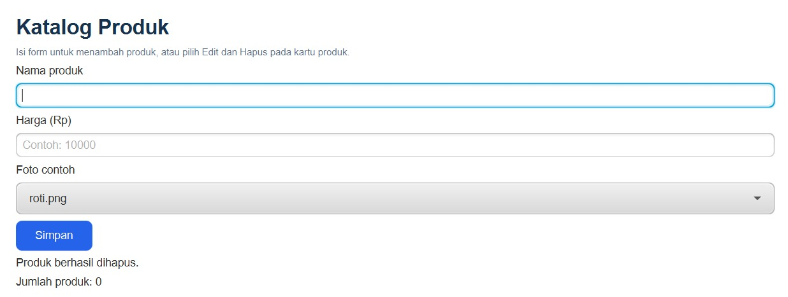
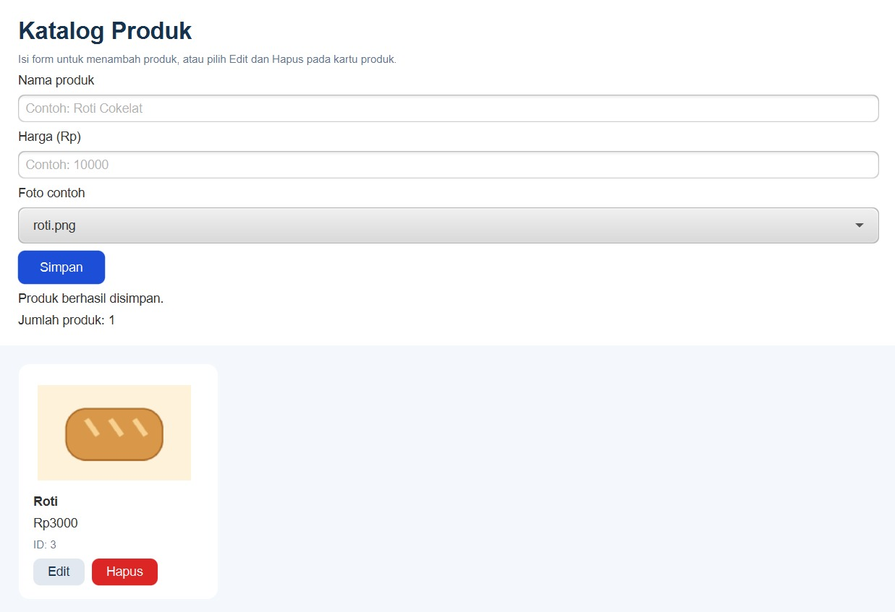
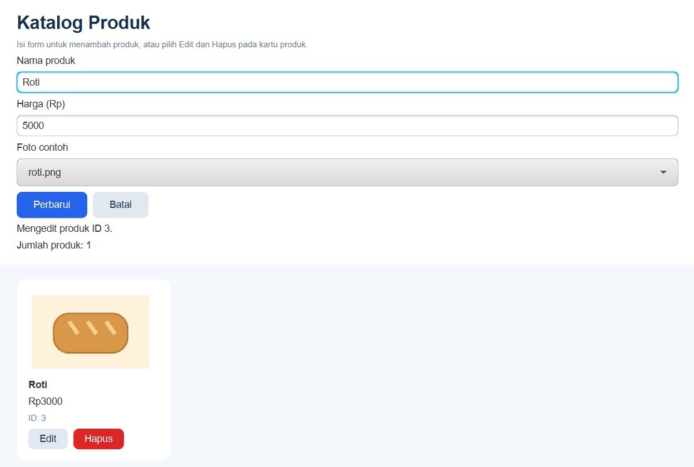
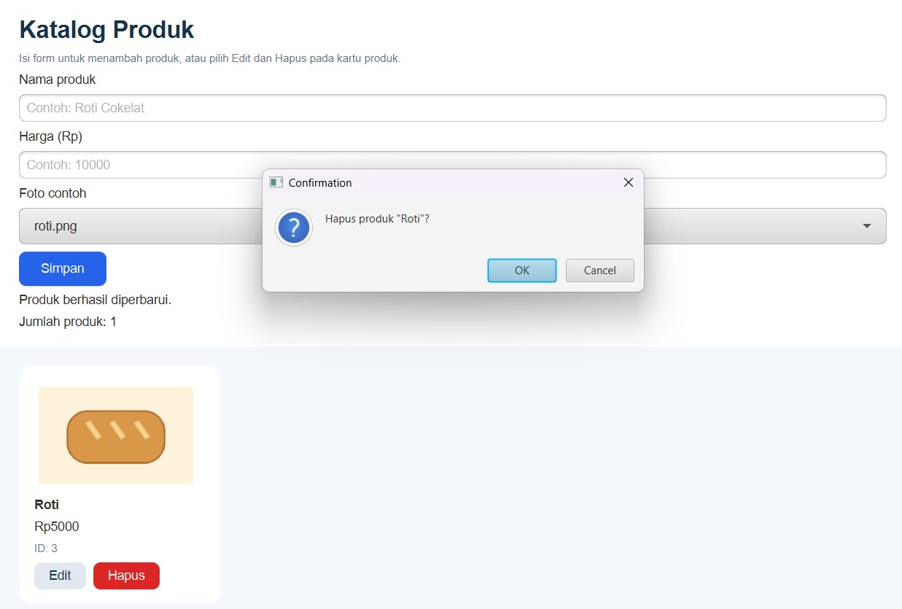
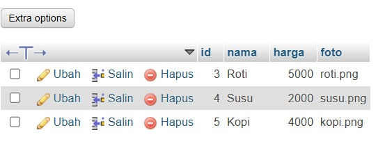

# Katalog Produk

Aplikasi desktop JavaFX untuk mengelola katalog produk toko. Data disimpan di database MySQL (XAMPP) dan bisa ditambah, diedit, serta dihapus.

## Fitur

- Tambah produk (nama, harga, foto contoh)
- Tampilan katalog dalam bentuk kartu produk
- Edit produk
- Hapus produk dengan dialog konfirmasi
- Penyimpanan data ke MySQL

## Screenshot

### Tampilan awal


### Tambah produk


### Edit produk


### Hapus produk


### Database di phpMyAdmin


## Kebutuhan

- JDK 17 atau lebih baru
- Apache NetBeans (atau IDE lain yang mendukung Maven)
- XAMPP (Apache dan MySQL)

## Cara Menjalankan

### 1. Clone project

```
git clone https://github.com/aflahrusyda02/KatalogProduk.git
```

Lalu buka folder `KatalogProduk` di NetBeans (File > Open Project).

### 2. Siapkan database

1. Buka XAMPP Control Panel, klik **Start** pada **Apache** dan **MySQL**.
2. Buka `http://localhost/phpmyadmin`.
3. Buat database baru bernama `katalog_db`.
4. Buka tab **SQL**, jalankan perintah berikut untuk membuat user aplikasi:

```sql
CREATE USER 'katalog'@'localhost' IDENTIFIED BY 'katalog123';
GRANT ALL PRIVILEGES ON katalog_db.* TO 'katalog'@'localhost';
FLUSH PRIVILEGES;
```

Tabel `produk` dibuat otomatis oleh aplikasi saat pertama kali dijalankan.

Pengaturan koneksi ada di `src/main/java/db/Database.java`. Sesuaikan `USER` dan `PASSWORD` jika berbeda.

### 3. Jalankan aplikasi

Di NetBeans: klik kanan project, pilih **Clean and Build**, lalu **Run**.

Atau lewat terminal di folder project:

```
mvn clean javafx:run
```

## Cara Memakai

1. Isi nama produk, harga, dan pilih foto, lalu klik **Simpan**.
2. Untuk mengubah data, klik **Edit** pada kartu produk, ubah isinya, lalu klik **Perbarui**. Klik **Batal** untuk membatalkan.
3. Untuk menghapus, klik **Hapus** pada kartu produk, lalu konfirmasi dengan **OK**.

## Struktur Project

```
src/main/java
    main/         MainApp dan Launcher
    controller/   KatalogController
    data/         ProdukRepository
    db/           Database
    model/        Produk
src/main/resources
    view/         katalog.fxml dan styles/app.css
    image/        foto contoh produk
```